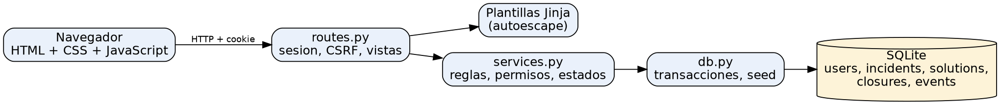
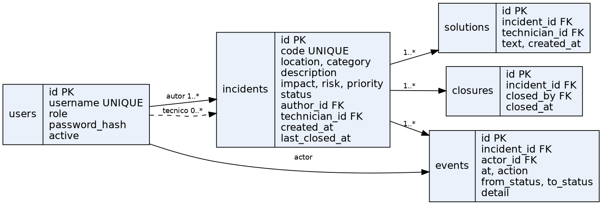
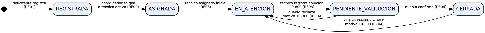
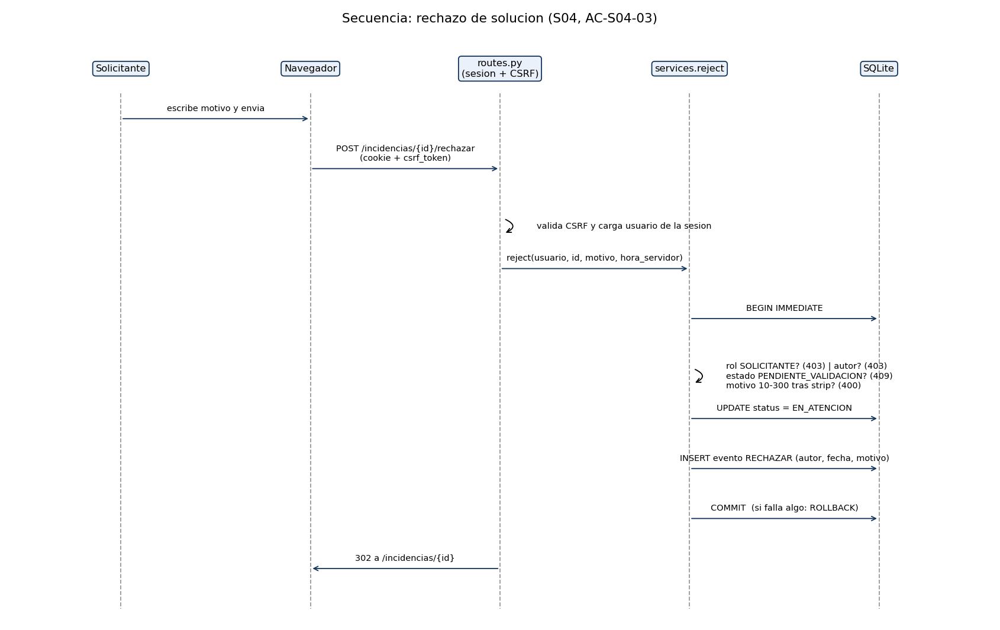

# 1. Portada

**Universidad Simón Bolívar — Programa de Ingeniería de Sistemas — Ingeniería de Software I**

**Examen:** Específica. Construye. Verifica. (SDD + IA) — Caso ReparaCampus

**Equipo:** [COMPLETAR nombre del equipo]

| Integrante | Código |
|---|---|
| [COMPLETAR] | [COMPLETAR] |
| [COMPLETAR] | [COMPLETAR] |
| [COMPLETAR] | [COMPLETAR] |

**Grupo:** [COMPLETAR] — **Docente:** [COMPLETAR] — **Fecha:** [COMPLETAR]

# 2. Índice

*(En Word: Referencias → Tabla de contenido → Actualizar, con títulos numerados y páginas numeradas.)*

# 3. Problema y alcance

**Necesidad.** La coordinación de mantenimiento recibe reportes de daños por varios canales, los atiende por otro y a veces los da por cerrados sin saber si quedaron resueltos. Se requiere un prototipo para registrar, priorizar, asignar y comprobar la solución de incidencias de infraestructura.

**Actores y permisos.**

| Actor | Puede | No puede |
|---|---|---|
| Solicitante | Registrar; consultar las propias; confirmar, rechazar o reabrir **sus** soluciones | Ver o actuar sobre incidencias ajenas |
| Coordinador | Consultar todas; asignar un técnico activo a una REGISTRADA; ver el tablero | Confirmar, rechazar o reabrir por el solicitante; reasignar |
| Técnico | Consultar sus asignaciones; iniciar atención; registrar solución | Actuar sobre incidencias no asignadas; cerrar |

**Requisitos.** RF01 Registrar · RF02 Priorizar y asignar · RF03 Atender · RF04 Validar · RF05 Consultar e historizar (ver enunciado del examen).

**Historias ↔ requisitos.** S01↔RF01, S02↔RF02, S03↔RF03, S04↔RF04, S05↔RF05.

**Límites del prototipo.** Ubicaciones LAB-01, AULA-201, BIB-01; categorías ELECTRICIDAD, HIDRAULICA, MOBILIARIO, TIC; sin especialidad de técnico; 2 solicitantes, 1 coordinador y 2 técnicos ficticios; sin adjuntos, notificaciones, hosting ni IA en el producto.

### Tres preguntas útiles al cliente (coordinación de mantenimiento)
1. Si un técnico no puede atender una incidencia ASIGNADA, ¿cómo debe comunicarlo, dado que no hay reasignación en esta versión?
2. ¿En qué zona horaria deben mostrarse las fechas, y desde cuándo se cuentan las 48 h cuando una incidencia se cierra más de una vez?
3. ¿Los solicitantes deben ver el nombre del técnico asignado y el historial completo de su incidencia?

### Supuestos pendientes de confirmación (no son decisiones del cliente)
| ID | Supuesto adoptado | Estado |
|---|---|---|
| A1 | Sin reasignación: si el técnico no puede atender, se resuelve fuera del sistema | PENDIENTE de respuesta del cliente |
| A2 | Fechas guardadas y mostradas en UTC; las 48 h se cuentan desde el **último** cierre | PENDIENTE de respuesta del cliente |
| A3 | El solicitante dueño ve técnico e historial de sus propias incidencias | PENDIENTE de respuesta del cliente |
| A4 | Código con formato `INC-NNNN` consecutivo | Decisión del equipo |


# 4. SPECS

*Antes de implementar cada SPEC, otro integrante la revisa y deja fecha, versión y decisión (campos [PENDIENTE]). Adjunten la evidencia del commit de revisión.*

### SPEC S01 — Registrar incidencia

- **Versión / autor / revisor / fecha:** v0.1 / [AUTOR] / [REVISOR] / [FECHA]  ← *completar: la revisión por otro integrante debe ocurrir antes del código*
- **Requisito asociado:** RF01
- **Historia:** Como **solicitante**, quiero registrar una incidencia con ubicación, categoría, descripción, impacto y riesgo, para que mantenimiento pueda priorizarla y atenderla.

#### Alcance y exclusiones
Incluye registro, generación de código/autor/fecha/estado y evento de creación. Excluye edición de reportes, adjuntos y notificaciones.

#### Entradas
| Campo | Tipo | Obligatorio | Valores / límites |
|---|---|---|---|
| ubicacion | texto | sí | LAB-01, AULA-201, BIB-01 |
| categoria | texto | sí | ELECTRICIDAD, HIDRAULICA, MOBILIARIO, TIC |
| impacto | texto | sí | BAJO, ALTO (exacto, en mayúsculas) |
| riesgo | booleano | sí | `true` o `false` |
| descripcion | texto | sí | 20 a 500 caracteres **después de retirar espacios externos** |

#### Precondiciones y permisos
Sesión iniciada con rol SOLICITANTE. Coordinador y técnico no registran (403). Sin sesión → redirección a login.

#### Reglas y proceso
1. Validar CSRF y rol. 2. Normalizar texto (strip). 3. Validar valores permitidos y longitud. 4. Calcular prioridad (ver S02). 5. En **una transacción**: insertar incidencia (código `INC-NNNN`, autor = usuario de la sesión, fecha = reloj del servidor UTC, estado REGISTRADA) e insertar evento CREAR.

#### Salidas y cambios persistidos
Incidencia REGISTRADA + evento CREAR (autor, fecha, estado inicial/final, acción). Respuesta 302 al detalle.

#### Errores y efectos que deben evitarse
Dato faltante o inválido → 400 sin escribir nada. Texto con HTML se muestra escapado (nunca se ejecuta). El cliente no elige autor, fecha, estado ni prioridad.

#### Criterios de aceptación
- **AC-S01-01** Dado un solicitante autenticado, cuando envía datos válidos, entonces se crea la incidencia INC-0001 en REGISTRADA con su autor, fecha UTC del servidor y un evento CREAR.
- **AC-S01-02** Dado un coordinador, un técnico o un visitante sin sesión, cuando intenta registrar, entonces recibe 403 (o redirección a login) y no se crea nada.
- **AC-S01-03** Dado un solicitante, cuando omite cualquier campo obligatorio, entonces recibe 400 y no hay incidencia ni evento nuevos.
- **AC-S01-04** Dado un solicitante, cuando envía ubicación, categoría, impacto o riesgo fuera de los valores permitidos (p. ej. impacto `MEDIO`, riesgo `quiza`), entonces recibe 400 sin efectos.
- **AC-S01-05** Dado un solicitante, cuando la descripción tiene 19 caracteres (también 19 + espacios externos) o 501, entonces se rechaza; con 20 o 500 se acepta.
- **AC-S01-06** Dada una descripción `<script>alert('x')</script> luz`, cuando se consulta el detalle, entonces el texto aparece escapado y no se ejecuta.
- **AC-S01-07** Dado un POST sin token CSRF válido, cuando se envía, entonces recibe 400 sin efectos.

#### Diseño y tareas vinculadas
| Tarea | AC | Artefacto |
|---|---|---|
| T01 Esquema `incidents`/`events` con CHECK de valores permitidos | 01, 04 | `app/schema.sql` |
| T02 `create_incident` transaccional | 01, 03, 05 | `app/services.py` |
| T03 Ruta y formulario `/incidencias/nueva` | 01, 02, 07 | `routes.py`, `new.html` |
| T04 Escape de salida (autoescape Jinja) | 06 | `templates/` |

#### Pruebas y resultados esperados
`tests/test_s01_registrar.py` (6 pruebas). Esperado: todas pasan; tras un rechazo, `COUNT(incidents)` y `COUNT(events)` no cambian.

#### Decisión de revisión / versión aprobada
[PENDIENTE: Aprobada / Con cambios — revisor, fecha, versión]


### SPEC S02 — Priorizar y asignar

- **Versión / autor / revisor / fecha:** v0.1 / [AUTOR] / [REVISOR] / [FECHA]
- **Requisito asociado:** RF02
- **Historia:** Como **coordinador**, quiero que cada incidencia tenga prioridad calculada y asignarla a un técnico activo, para que se atienda primero lo más urgente.

#### Alcance y exclusiones
Cálculo de prioridad y asignación inicial. Sin restricción de especialidad del técnico. Excluye reasignación.

#### Entradas
`tecnico_id` (entero, id de un usuario con rol TECNICO y `active = 1`). La prioridad **no** es una entrada.

#### Precondiciones y permisos
Rol COORDINADOR. Incidencia en REGISTRADA.

#### Reglas y proceso
- Prioridad: riesgo = true → **CRITICA**; riesgo = false e impacto ALTO → **ALTA**; riesgo = false e impacto BAJO → **NORMAL**. Se calcula en el servidor al registrar.
- Asignar: en una transacción, comprobar rol, existencia, estado REGISTRADA y técnico válido/activo; pasar a ASIGNADA con `technician_id` y registrar evento ASIGNAR.

#### Salidas y cambios persistidos
Incidencia ASIGNADA con técnico + evento ASIGNAR (autor = coordinador).

#### Errores y efectos que deben evitarse
Rol distinto → 403. Incidencia inexistente → 404. Estado distinto de REGISTRADA (incluye reasignar) → 409. Técnico inexistente/inactivo/no técnico/no numérico → 400. Ninguno modifica estado ni historial.

#### Criterios de aceptación
- **AC-S02-01** Dado un registro, cuando (riesgo, impacto) es (true, ALTO), (true, BAJO), (false, ALTO), (false, BAJO), entonces la prioridad es CRITICA, CRITICA, ALTA, NORMAL respectivamente.
- **AC-S02-02** Dado un coordinador y una incidencia REGISTRADA, cuando asigna a un técnico activo, entonces pasa a ASIGNADA con ese técnico y se registra ASIGNAR.
- **AC-S02-03** Dado un solicitante o un técnico, cuando intenta asignar, entonces recibe 403 sin cambios.
- **AC-S02-04** Dada una incidencia ya ASIGNADA, cuando el coordinador intenta asignarla de nuevo (a otro técnico o al mismo), entonces recibe 409 y se conserva el técnico original y el historial.
- **AC-S02-05** Dado un técnico inactivo, un usuario que no es técnico, un id inexistente o no numérico, cuando se intenta asignar, entonces recibe 400 sin cambios.
- **AC-S02-06** Dado un formulario con un campo `prioridad` manipulado, cuando se registra, entonces el servidor lo ignora y calcula la prioridad.

#### Diseño y tareas vinculadas
| Tarea | AC | Artefacto |
|---|---|---|
| T05 `compute_priority` | 01, 06 | `services.py` |
| T06 `assign` transaccional con validación de técnico | 02–05 | `services.py` |
| T07 Ruta `POST /incidencias/<id>/asignar` y selector de técnicos activos | 02, 03 | `routes.py`, `detail.html` |

#### Pruebas y resultados esperados
`tests/test_s02_priorizar_asignar.py` (6 pruebas).

#### Decisión de revisión / versión aprobada
[PENDIENTE]


### SPEC S03 — Atender

- **Versión / autor / revisor / fecha:** v0.1 / [AUTOR] / [REVISOR] / [FECHA]
- **Requisito asociado:** RF03
- **Historia:** Como **técnico asignado**, quiero iniciar la atención y registrar la solución, para que el solicitante pueda validarla.

#### Alcance y exclusiones
Transiciones ASIGNADA→EN_ATENCION y EN_ATENCION→PENDIENTE_VALIDACION. Excluye cierre y reasignación.

#### Entradas
`solucion`: texto de 20 a 800 caracteres tras strip (solo al registrar solución).

#### Precondiciones y permisos
Rol TECNICO **y** ser el técnico asignado a esa incidencia (se comprueba en el servidor).

#### Reglas y proceso
Iniciar: estado ASIGNADA → EN_ATENCION (evento INICIAR). Registrar solución: estado EN_ATENCION; en una transacción insertar la solución (tabla `solutions`, nunca se sobrescribe), pasar a PENDIENTE_VALIDACION y registrar REGISTRAR_SOLUCION con el texto.

#### Salidas y cambios persistidos
Cambio de estado + evento; nueva fila en `solutions` al registrar solución.

#### Errores y efectos que deben evitarse
Otro rol o técnico no asignado → 403. Estado incorrecto (p. ej. solución en ASIGNADA) → 409. Longitud fuera de rango → 400. Sin efectos parciales.

#### Criterios de aceptación
- **AC-S03-01** Dado el técnico asignado y una incidencia ASIGNADA, cuando inicia la atención, entonces pasa a EN_ATENCION y se registra INICIAR.
- **AC-S03-02** Dado otro técnico, un solicitante o el coordinador, cuando intenta iniciar, entonces recibe 403 sin cambios.
- **AC-S03-03** Dada una incidencia ASIGNADA (no iniciada), cuando el técnico registra una solución, entonces recibe 409 y no se guarda solución.
- **AC-S03-04** Dado el técnico asignado y una incidencia EN_ATENCION, cuando registra una solución válida, entonces pasa a PENDIENTE_VALIDACION, se guarda el texto y se registra el evento.
- **AC-S03-05** Dada una solución de 19 caracteres (o 801), cuando se envía, entonces se rechaza con 400; de 20 u 800 se acepta.
- **AC-S03-06** Dado un técnico no asignado, cuando intenta registrar solución, entonces recibe 403 sin cambios.

#### Diseño y tareas vinculadas
| Tarea | AC | Artefacto |
|---|---|---|
| T08 `start` y `solve` transaccionales | 01, 03–05 | `services.py` |
| T09 Comprobación de pertenencia del técnico | 02, 06 | `_assigned_technician` |
| T10 Formularios en el detalle | 01, 04 | `detail.html` |

#### Pruebas y resultados esperados
`tests/test_s03_atender.py` (6 pruebas).

#### Decisión de revisión / versión aprobada
[PENDIENTE]


### SPEC S04 — Validar solución, rechazar y reabrir

- **Versión / autor / revisor / fecha:** v0.1 / [AUTOR] / [REVISOR] / [FECHA]
- **Requisito asociado:** RF04
- **Historia:** Como **solicitante dueño**, quiero confirmar, rechazar o reabrir la solución de mi incidencia, para asegurarme de que el problema quedó resuelto de verdad.

#### Alcance y exclusiones
Confirmar (→CERRADA), rechazar (→EN_ATENCION) y reabrir (CERRADA→EN_ATENCION, ≤ 48 h). Sin cierre automático; el coordinador no actúa en nombre del solicitante.

#### Entradas
`motivo` (rechazo/reapertura): 10 a 300 caracteres tras strip.

#### Precondiciones y permisos
Rol SOLICITANTE **y** ser el autor de la incidencia.

#### Reglas y proceso
- Confirmar: estado PENDIENTE_VALIDACION → CERRADA; insertar fila en `closures` y fijar `last_closed_at` = hora del servidor (UTC).
- Rechazar: PENDIENTE_VALIDACION → EN_ATENCION, mismo técnico, soluciones conservadas; evento RECHAZAR con el motivo.
- Reabrir: estado CERRADA y `ahora − last_closed_at ≤ 48 h` (el reloj es del servidor; el navegador no envía hora) → EN_ATENCION con el mismo técnico; evento REABRIR con el motivo. Cierres y soluciones anteriores se conservan.

#### Salidas y cambios persistidos
Estado, evento y, al confirmar, un cierre nuevo. Nada se borra ni se sobrescribe.

#### Errores y efectos que deben evitarse
No dueño o coordinador/técnico → 403. Estado incorrecto o plazo vencido → 409. Motivo fuera de rango → 400. Operación rechazada: estado e historial intactos.

#### Criterios de aceptación
- **AC-S04-01** Dado el dueño y una incidencia PENDIENTE_VALIDACION, cuando confirma, entonces queda CERRADA, con un cierre y `last_closed_at` registrados.
- **AC-S04-02** Dado otro solicitante, el coordinador o un técnico, cuando intenta confirmar, entonces recibe 403 sin cambios.
- **AC-S04-03** Dado el dueño y una incidencia PENDIENTE_VALIDACION con técnico T y solución registrada, cuando la rechaza con «El daño sigue presente», entonces queda EN_ATENCION, conserva T y la solución anterior, y registra quién rechazó, cuándo y por qué.
- **AC-S04-04** Dado un motivo de 9 caracteres (o 301, o vacío), cuando se rechaza, entonces recibe 400 y el estado y el historial no cambian; con 10 se acepta.
- **AC-S04-05** Dada una incidencia CERRADA exactamente 48 h antes, cuando el dueño la reabre con motivo válido, entonces queda EN_ATENCION con el mismo técnico.
- **AC-S04-06** Dada una incidencia CERRADA hace 48 h y 1 s, cuando el dueño intenta reabrirla, entonces recibe 409 y no cambia nada.
- **AC-S04-07** Dado otro solicitante o el coordinador intentando reabrir → 403; una incidencia no cerrada → 409; motivo corto → 400; sin cambios.
- **AC-S04-08** Dada una incidencia cerrada, reabierta, re-solucionada y cerrada de nuevo, entonces existen dos cierres y dos soluciones, ambos conservados.

#### Diseño y tareas vinculadas
| Tarea | AC | Artefacto |
|---|---|---|
| T11 `confirm`, `reject`, `reopen` | 01–08 | `services.py` |
| T12 Reloj inyectable (`CLOCK`) para probar 48 h | 05, 06 | `create_app` |
| T13 Tablas `closures`/`solutions` inmutables (triggers) | 08 | `schema.sql` |

#### Pruebas y resultados esperados
`tests/test_s04_validar.py` (7) + `tests/test_integracion.py` (INT-02, INT-03).

#### Decisión de revisión / versión aprobada
[PENDIENTE]


### SPEC S05 — Consultar e historizar

- **Versión / autor / revisor / fecha:** v0.1 / [AUTOR] / [REVISOR] / [FECHA]
- **Requisito asociado:** RF05
- **Historia:** Como **usuario del sistema**, quiero consultar las incidencias que me corresponden con filtros y ver su historial inmutable; como **coordinador**, quiero un tablero con cantidades y porcentaje de cierre, para dar seguimiento.

#### Alcance y exclusiones
Listado con filtros, detalle con historial, tablero, autenticación y persistencia. Excluye exportaciones y notificaciones.

#### Entradas
`estado` (uno de los 5 estados) y `prioridad` (CRITICA/ALTA/NORMAL), opcionales.

#### Precondiciones y permisos
Sesión iniciada. Solicitante: solo sus incidencias. Técnico: solo las asignadas. Coordinador: todas y el tablero.

#### Reglas y proceso
- Cada creación y transición exitosa inserta un evento (autor, fecha, estado origen/destino, acción, detalle) en la **misma transacción** que el cambio.
- Eventos, soluciones y cierres no se editan ni se borran (triggers de SQLite).
- Tablero: conteo por estado y por prioridad, lista de CRITICA no cerradas y porcentaje = CERRADAS / total × 100 con un decimal (redondeo half-up), formato `25,0 %`; con 0 registros `0,0 %`.
- Contraseñas con hash (scrypt/pbkdf2 de Werkzeug); identidad y rol salen de la sesión del servidor.

#### Salidas y cambios persistidos
Vistas de listado, detalle y tablero. Los datos persisten en el archivo SQLite al reiniciar.

#### Errores y efectos que deben evitarse
Filtro inválido → 400. Detalle ajeno → 403; inexistente → 404. Tablero para no coordinador → 403. Una operación fallida no deja eventos.

#### Criterios de aceptación
- **AC-S05-01** Dadas incidencias de dos solicitantes y una asignada a tec1, cuando cada rol consulta, entonces sol1/sol2 ven solo las suyas, tec1 solo la asignada, tec2 ninguna y el coordinador todas.
- **AC-S05-02** Dados filtros por estado y/o prioridad, cuando se consulta, entonces solo aparecen las coincidentes; un valor inválido devuelve 400.
- **AC-S05-03** Dadas las 5 cuentas ficticias, cuando inician sesión, entonces entran; con clave errónea no; en la base solo hay hashes; al cerrar sesión se pierde el acceso.
- **AC-S05-04** Dada una incidencia con historial, cuando se intenta UPDATE/DELETE sobre eventos, soluciones o cierres, entonces la base lo rechaza; el flujo completo deja 5 eventos en el orden esperado.
- **AC-S05-05** Dado otro solicitante o un técnico no asignado, cuando abre el detalle, entonces recibe 403; un id inexistente devuelve 404.
- **AC-S05-06** Dado el coordinador, cuando abre el tablero, entonces ve conteos por estado y prioridad y las CRITICA no cerradas; solicitante y técnico reciben 403.
- **AC-S05-07** Dado el tablero, entonces: 0 registros → `0,0 %`; 1 cerrada de 4 → `25,0 %`; reabrir esa incidencia → `0,0 %` conservando su cierre anterior; 2 de 4 → `50,0 %`.
- **AC-S05-08** Dado un servidor reiniciado, entonces estados, soluciones, cierres e historial siguen presentes.

#### Diseño y tareas vinculadas
| Tarea | AC | Artefacto |
|---|---|---|
| T14 Login/logout, hash, CSRF, carga de usuario por sesión | 03 | `routes.py` |
| T15 `list_incidents`, `get_detail` con alcance por rol | 01, 02, 05 | `services.py` |
| T16 `dashboard` y `format_percent` | 06, 07 | `services.py`, `dashboard.html` |
| T17 Triggers de inmutabilidad y seed | 04, 08 | `schema.sql`, `db.py` |

#### Pruebas y resultados esperados
`tests/test_s05_consultar_historial.py` (8) + `tests/test_integracion.py` (INT-01).

#### Decisión de revisión / versión aprobada
[PENDIENTE]


# 5. Diseño

## 5.1 Componentes


Interfaz (HTML/CSS/JS), capa web (`routes.py`: sesión, CSRF, vistas), lógica (`services.py`: reglas, permisos, estados) y persistencia (`db.py` + SQLite).

## 5.2 Modelo de datos


`incidents` guarda el estado actual; `solutions`, `closures` y `events` son registros históricos que nunca se editan ni se borran (triggers).

## 5.3 UML de estados


## 5.4 UML de secuencia — rechazo de solución


## 5.5 Decisión tecnológica

**Decisión:** monolito modular en Flask con SQLite, plantillas Jinja y reglas en una capa de servicios (`services.py`) separada de las rutas (`routes.py`).

| Alternativa | Ventajas | Por qué no |
|---|---|---|
| Django | Autenticación y administración incluidas | Más estructura y curva de aprendizaje de la necesaria para 5 historias y una semana |
| FastAPI + React | Separación fuerte front/back | Dos proyectos, más superficie de errores y tiempo; el caso no exige SPA |
| Reglas en el navegador | Respuesta inmediata | Incumple el requisito: el servidor debe validar permisos y reglas |

**Consecuencias:** despliegue y arranque sencillos (un proceso, un archivo de base de datos), pruebas con el cliente de Flask sobre SQLite real, y fácil de explicar. Costos: SQLite admite un solo escritor a la vez (se mitiga con transacciones cortas `BEGIN IMMEDIATE`) y una interfaz menos dinámica. La separación rutas/servicios permite cambiar la capa web sin tocar las reglas.

**Dónde se ejecuta cada cosa:** interfaz = HTML/JS (solo conveniencia); lógica y permisos = `services.py`; persistencia e inmutabilidad = SQLite (restricciones CHECK, FK y triggers).


# 6. Implementación con IA

**Herramientas y versiones.** Python 3.12.3 · Flask 3.1.3 · Werkzeug 3.1.7 · SQLite (módulo estándar) · pytest [COMPLETAR versión] · Git/GitHub · diagrams.net o PlantUML · asistente de IA: [COMPLETAR herramienta y modelo].

## 6.1 Bitácora de IA (cuatro intervenciones)

> **Atención:** esta bitácora debe contener **sus** intervenciones reales con el asistente de IA. No copien los ejemplos de abajo como si fueran suyos. Registren cuatro: especificación, código, pruebas y revisión. No inventen errores: si aceptaron el resultado, registren la comprobación que lo justifica.

### Intervención N.º __ (copiar la plantilla cuatro veces)
- **Fecha / autor / herramienta / modelo:**
- **Historia y SPEC / versión:**
- **Objetivo y contexto:**
- **Prompt o instrucción:**
- **Respuesta relevante:**
- **Decisión humana y justificación:** (qué aceptaron, corrigieron o descartaron)
- **Error o limitación, si existe:**
- **Corrección y verificación:**
- **Archivo / commit / prueba:**

#### Ideas de enfoque (sugerencias, no registros)
1. *Especificación:* pedir a la IA que revise la SPEC S04 buscando ambigüedades; decidir qué cambios se aceptan.
2. *Código:* «Implementa solo AC-S02-01 y AC-S02-02. Usa la SPEC S02 y el modelo de estados. No agregues transiciones. Indica dudas y archivos modificados».
3. *Pruebas:* pedir pruebas para AC-S04-05/06 con un reloj controlado; verificar que el esperado no se calcule con código de producción.
4. *Revisión:* pedir una revisión de permisos de una ruta y contrastarla con la matriz de la SPEC.


## 6.2 Evidencia por funcionalidad

| Funcionalidad | Módulo / archivo | Pruebas | Evidencia (captura explicada / commit) |
|---|---|---|---|
| RF01 Registrar | `services.create_incident`, `new.html` | S01 | [COMPLETAR] |
| RF02 Priorizar y asignar | `compute_priority`, `assign` | S02 | [COMPLETAR] |
| RF03 Atender | `start`, `solve` | S03 | [COMPLETAR] |
| RF04 Validar | `confirm`, `reject`, `reopen` | S04 + integración | [COMPLETAR] |
| RF05 Consultar e historizar | `list_incidents`, `get_detail`, `dashboard` | S05 | [COMPLETAR] |

# 7. Validación

## 7.1 Matriz de trazabilidad

| Requisito | Historia | SPEC | Código | Prueba |
|---|---|---|---|---|
| RF01 | H01 | S01 (AC-S01-01…07) | `create_incident`, schema CHECK | `test_s01_registrar.py` |
| RF02 | H02 | S02 (AC-S02-01…06) | `compute_priority`, `assign` | `test_s02_priorizar_asignar.py` |
| RF03 | H03 | S03 (AC-S03-01…06) | `start`, `solve` | `test_s03_atender.py` |
| RF04 | H04 | S04 (AC-S04-01…08) | `confirm`, `reject`, `reopen` | `test_s04_validar.py`, `test_integracion.py` |
| RF05 | H05 | S05 (AC-S05-01…08) | `list_incidents`, `get_detail`, `dashboard`, triggers | `test_s05_consultar_historial.py` |

## 7.2 Catálogo de pruebas automatizadas (36 pruebas, 3 de integración)

Comando: `pytest -v` — Fecha: [COMPLETAR] — SHA: [COMPLETAR] — Resultado: [PEGAR resumen de pytest].

| ID | Prueba (pytest) | SPEC/AC | Entrada y esperado (escritos antes de ejecutar) | Observado / fecha / SHA |
|---|---|---|---|---|
| T01 | test_flujo_de_cierre | INT-01 | INT-01: registrar -> asignar -> iniciar -> solucion -> confirmar. | [COMPLETAR] |
| T02 | test_flujo_con_rechazo_y_nueva_solucion | INT-02 | INT-02: rechazo conserva tecnico y solucion; nueva solucion; cierre. | [COMPLETAR] |
| T03 | test_cierre_reapertura_nueva_solucion_y_nuevo_cierre | INT-03 | INT-03: se conservan ambos cierres y ambas soluciones; reapertura con el mismo tecnico. | [COMPLETAR] |
| T04 | test_registro_valido_crea_reporte_registrada | AC-S01-01 | AC-S01-01: datos validos -> REGISTRADA con codigo, autor, fecha y evento CREAR. | [COMPLETAR] |
| T05 | test_solo_solicitante_registra_y_sin_sesion_redirige | AC-S01-02 | AC-S01-02: coordinador/tecnico -> 403; sin sesion -> login; sin efectos. | [COMPLETAR] |
| T06 | test_campos_obligatorios_y_valores_invalidos_rechazados | AC-S01-03, AC-S01-04 | AC-S01-03 / AC-S01-04: faltantes e invalidos -> 400 y nada se guarda. | [COMPLETAR] |
| T07 | test_limites_de_descripcion_con_strip | AC-S01-05 | AC-S01-05: 19 rechaza, 20 acepta, 500 acepta, 501 rechaza; espacios externos no cuentan. | [COMPLETAR] |
| T08 | test_texto_con_html_no_se_ejecuta | AC-S01-06 | AC-S01-06: el texto parecido a HTML se muestra escapado. | [COMPLETAR] |
| T09 | test_csrf_es_obligatorio | AC-S01-07 | AC-S01-07: un POST sin token valido se rechaza sin efectos. | [COMPLETAR] |
| T10 | test_prioridad_se_calcula_en_el_servidor | AC-S02-01 | AC-S02-01: riesgo->CRITICA; sin riesgo ALTO->ALTA; sin riesgo BAJO->NORMAL. | [COMPLETAR] |
| T11 | test_prioridad_enviada_por_el_cliente_se_ignora | AC-S02-06 | AC-S02-06: un campo prioridad en el formulario no cambia el calculo. | [COMPLETAR] |
| T12 | test_coordinador_asigna_registrada_a_tecnico_activo | AC-S02-02 | AC-S02-02: REGISTRADA -> ASIGNADA con tecnico y evento ASIGNAR. | [COMPLETAR] |
| T13 | test_solo_coordinador_asigna | AC-S02-03 | AC-S02-03: solicitante y tecnico -> 403 sin cambios. | [COMPLETAR] |
| T14 | test_asignacion_repetida_o_reasignacion_rechazada | AC-S02-04 | AC-S02-04: ya ASIGNADA no se reasigna; conserva tecnico e historial. | [COMPLETAR] |
| T15 | test_tecnico_inactivo_inexistente_o_no_tecnico_rechazado | AC-S02-05 | AC-S02-05: 400 y sin cambios. | [COMPLETAR] |
| T16 | test_tecnico_asignado_inicia_atencion | AC-S03-01 | AC-S03-01: ASIGNADA -> EN_ATENCION con evento INICIAR. | [COMPLETAR] |
| T17 | test_no_asignado_u_otro_rol_no_inicia | AC-S03-02 | AC-S03-02: otro tecnico, solicitante y coordinador -> 403 sin cambios. | [COMPLETAR] |
| T18 | test_solucion_antes_de_iniciar_rechazada | AC-S03-03 | AC-S03-03: en ASIGNADA no se registra solucion (409). | [COMPLETAR] |
| T19 | test_solucion_valida_pasa_a_pendiente_validacion | AC-S03-04 | AC-S03-04: EN_ATENCION -> PENDIENTE_VALIDACION con solucion y evento. | [COMPLETAR] |
| T20 | test_limites_de_solucion | AC-S03-05 | AC-S03-05: 19 y 801 rechazan; 20 y 800 aceptan (con strip). | [COMPLETAR] |
| T21 | test_tecnico_no_asignado_no_registra_solucion | AC-S03-06 | AC-S03-06: otro tecnico -> 403 sin cambios. | [COMPLETAR] |
| T22 | test_solicitante_duenio_confirma_y_cierra | AC-S04-01 | AC-S04-01: PENDIENTE_VALIDACION -> CERRADA; registra cierre y evento. | [COMPLETAR] |
| T23 | test_ajeno_o_coordinador_no_confirma | AC-S04-02 | AC-S04-02: otro solicitante, coordinador y tecnico -> 403 sin cambios. | [COMPLETAR] |
| T24 | test_rechazo_valido_conserva_tecnico_y_solucion | AC-S04-03 | AC-S04-03: vuelve a EN_ATENCION con el mismo tecnico; guarda quien/cuando/por que. | [COMPLETAR] |
| T25 | test_rechazo_con_motivo_invalido_no_cambia_nada | AC-S04-04 | AC-S04-04: 9 y 301 caracteres -> 400; 10 aceptado; sin efectos en los rechazados. | [COMPLETAR] |
| T26 | test_reapertura_a_las_48h_exactas_se_acepta | AC-S04-05 | AC-S04-05: <= 48 h desde el ultimo cierre -> EN_ATENCION con el mismo tecnico. | [COMPLETAR] |
| T27 | test_reapertura_pasadas_48h_se_rechaza_sin_cambios | AC-S04-06 | AC-S04-06: 48 h + 1 s -> 409; estado e historial intactos. | [COMPLETAR] |
| T28 | test_reapertura_ajeno_estado_incorrecto_y_motivo_invalido | AC-S04-07 | AC-S04-07: duenio ajeno/coordinador -> 403; no cerrada -> 409; motivo corto -> 400. | [COMPLETAR] |
| T29 | test_listado_segun_permisos | AC-S05-01 | AC-S05-01: solicitante solo propias; tecnico solo asignadas; coordinador todas. | [COMPLETAR] |
| T30 | test_filtros_por_estado_y_prioridad | AC-S05-02 | AC-S05-02: filtros correctos; valores invalidos -> 400. | [COMPLETAR] |
| T31 | test_detalle_de_incidencia_ajena_o_inexistente | AC-S05-05 | AC-S05-05: otro solicitante/tecnico no asignado -> 403; inexistente -> 404. | [COMPLETAR] |
| T32 | test_historial_no_se_edita_ni_borra | AC-S05-04 | AC-S05-04: la base rechaza UPDATE/DELETE sobre eventos, soluciones y cierres. | [COMPLETAR] |
| T33 | test_tablero_solo_coordinador_con_conteos_y_criticas | AC-S05-06 | AC-S05-06: conteos por estado y prioridad; CRITICA no cerradas; acceso restringido. | [COMPLETAR] |
| T34 | test_porcentaje_de_cierre | AC-S05-07 | AC-S05-07: vacio=0,0 %; 1 de 4=25,0 %; reabrir reduce y conserva el cierre anterior. | [COMPLETAR] |
| T35 | test_persistencia_tras_reinicio | AC-S05-08 | AC-S05-08: los datos y el historial sobreviven a reiniciar la aplicacion. | [COMPLETAR] |
| T36 | test_login_logout_y_hash_de_contrasenas | AC-S05-03 | AC-S05-03: cuentas ficticias entran; clave incorrecta no; en BD solo hay hash. | [COMPLETAR] |

## 7.3 Comparación SPEC vs código

Para cada AC, completar: comportamiento esperado · archivo/módulo/commit · prueba y datos · resultado observado y efectos en la base · **Cumple / Parcial / No cumple** · diferencia detectada · corrección/regresión/evidencia final. *Si algo no se ejecutó o quedó incompleto, declárenlo como pendiente.*

**Hallazgo documentado durante el desarrollo:** la prueba AC-S01-07 (CSRF obligatorio) detectó que, tras iniciar sesión, el token de la sesión quedaba vacío y la comparación `"" == ""` aceptaba un POST sin token. Corrección: un token ausente nunca es válido y se genera un token nuevo al iniciar sesión. Regresión: 36 pruebas pasan. *(Verifiquen y registren con pytest real.)*

# 8. Riesgos

| ID | Tipo | Riesgo | Causa | Impacto | Control | Responsable | Evidencia de verificación |
|---|---|---|---|---|---|---|---|
| R1 | IA | La IA inventa que el técnico (u otro rol) puede cerrar un reporte | El prompt no incluye la matriz de permisos y la IA «completa» con lo que parece lógico | Cierres sin validación del dueño; incumple RF04 | La SPEC S04 fija quién puede cada acción; el servidor aplica `_require_role` y `_owned` en cada operación (no es una advertencia en el prompt); se pide a la IA cambios acotados por AC | [INTEGRANTE] | Pruebas AC-S04-02, AC-S03-02; mutación M3 (quitar la comprobación de dueño) hace fallar 2 pruebas |
| R2 | IA | Una prueba generada por IA acepta el mismo error del código | La IA deriva el esperado del código que escribió (circularidad) | Falsa sensación de cumplimiento | Esperados escritos a mano desde el AC antes de ejecutar; no se usa `compute_priority` ni `format_percent` en las pruebas; mutaciones manuales del código (M1: `>=` por `>` en 48 h; M2: borrar técnico al rechazar) | [INTEGRANTE] | Cada mutación debe hacer fallar al menos una prueba (ver tabla de mutaciones) |
| R3 | Producto | Un solicitante ve o actúa sobre reportes de otros | Permisos solo en la interfaz, o filtros olvidados en una ruta | Fuga de información y acciones indebidas | Identidad y rol salen de la sesión del servidor; `can_view`/`_owned` en cada operación; listado filtrado por rol en SQL; CSRF | [INTEGRANTE] | AC-S05-01, AC-S05-05, AC-S04-02/07; prueba CSRF AC-S01-07 |
| R4 | Equipo/Producto | Historial engañoso tras una operación fallida o editado después | Escritura parcial (cambia estado pero no evento) o historial modificable | Auditoría poco confiable; reportes «cerrados sin saber si quedó resuelto» | Una transacción por operación con ROLLBACK; triggers que impiden UPDATE/DELETE en eventos, soluciones y cierres | [INTEGRANTE] | AC-S05-04, AC-S04-04/06 (conteo de eventos antes/después), INT-01 a INT-03 |

### Mutaciones realizadas durante la preparación
| ID | Cambio al código | Pruebas que fallaron |
|---|---|---|
| M1 | Plazo de reapertura `>=` en lugar de `>` (rechaza justo a las 48 h) | `test_reapertura_a_las_48h_exactas_se_acepta` |
| M2 | El rechazo borra el técnico asignado | `test_rechazo_valido_conserva_tecnico_y_solucion`, `test_flujo_con_rechazo_y_nueva_solucion` |
| M3 | Se elimina la comprobación de dueño | `test_ajeno_o_coordinador_no_confirma`, `test_reapertura_ajeno_estado_incorrecto_y_motivo_invalido` |

*Repitan estas mutaciones con `pytest` real y registren fecha, comando y SHA antes de entregar.*


# 9. Entrega reproducible

- **Repositorio:** [COMPLETAR URL] — **Tag:** `release-examen` — **SHA exacto:** [COMPLETAR]
- Instalación, arranque, seed, cuentas ficticias y comandos de pruebas: ver el README del repositorio (resumen abajo).

```
python -m venv .venv && source .venv/bin/activate
pip install -r requirements.txt
flask --app run init-db
flask --app run run
pytest -v
```

**Limitaciones conocidas:** hora en UTC; mensajes de error genéricos; sin adjuntos ni notificaciones.

# 10. Contribuciones y cierre

| Integrante | Tareas | Artefactos / commits | Revisión realizada | Resultado |
|---|---|---|---|---|
| [COMPLETAR] | | | | |

**Conclusión de cumplimiento:** [COMPLETAR: qué cumple, qué queda pendiente]. **Aceptación del equipo:** [COMPLETAR].

# 11. Referencias

Flask — https://flask.palletsprojects.com · SQLite — https://www.sqlite.org/docs.html · pytest — https://docs.pytest.org · GitHub Issues — https://docs.github.com/issues · Enunciado del examen (sitio indicado por el docente).
